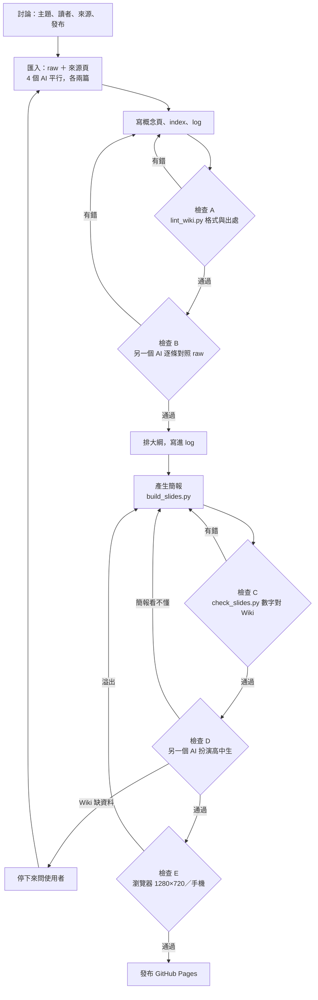

# 狹義相對論 LLM Wiki

一份給 AI 維護的狹義相對論入門知識庫（LLM Wiki），以及只用這份 Wiki 產生的教學 HTML 簡報，讀者是高中生／非物理系。

- 教學簡報：https://rich88970.github.io/special-relativity-wiki/slides/
- Wiki 目錄：[wiki/index.md](wiki/index.md)｜工作紀錄：[wiki/log.md](wiki/log.md)｜檢查紀錄：[checks/](checks/)
- 專案規則（給 AI）：[AGENTS.md](AGENTS.md)

## 結構

```
raw/        8 篇原始資料（S1 讀書網站講義、S2～S8 維基百科），匯入後不修改
wiki/       sources/ 來源頁、concepts/ 概念頁、index.md 目錄、log.md 紀錄
slides/     _content.html（內容）＋_frame.html（外框）→ index.html（成品）
checks/     每一輪檢查的報告
tools/      ingest_site.py 匯入、lint_wiki.py 檢查 A、check_slides.py 檢查 C、build_slides.py 組簡報
```

## 流程（loop / graph）



每項檢查最多 3 輪，還不過或發現缺資料就停下來問使用者。每一輪的報告都在 `checks/`，詳見 AGENTS.md 第 6 節。

## 授權與說明

- S2～S8 取自維基百科，依 CC BY-SA 4.0 授權（原文作者為維基百科貢獻者），raw/ 檔頭記有網址與版本；由它們整理的 wiki/ 內容同樣以 CC BY-SA 4.0 提供。
- S1 是使用者自己的讀書網站「讀懂物理」的講解文字。
- Wiki、簡報、程式與 AGENTS.md 由 Claude（Anthropic，透過 Claude Code）依使用者的需求與決定製作。
